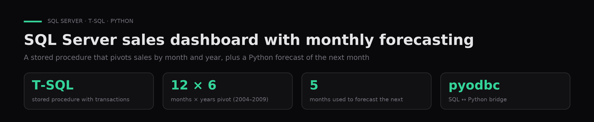

# SQL Server sales dashboard with monthly forecasting

**A stored procedure that builds a month-by-year sales table, and a Python script that forecasts the next month with linear regression on the previous 5 months.**

`SQL Server` · `T-SQL` · `Python` · `pyodbc` · `scikit-learn` · [Leer en español ↓](#español)

---

## Problem

Roll up transactional sales into a monthly table and estimate the next month.

## Data

The course `Ventas2` sales database (SQL Server, 2004–2009). `data/TableroVentas.csv` is the table the stored procedure produces.

## Approach

A T-SQL stored procedure with transactions and error handling, a monthly pivot, a pyodbc connection and linear regression with scikit-learn.

## Results

A dashboard regenerated by a single procedure, plus an on-demand monthly forecast.

**Security fix for publishing:** the original scripts had the SQL Server password hardcoded. They now read credentials from environment variables.

## How to run

1. Restore the `Ventas2` database on a SQL Server instance and run `sql/QueryFinal.sql` to create `sp_TableroVentas`.
2. `pip install -r requirements.txt` (needs the ODBC Driver 17 for SQL Server).
3. Set the connection through environment variables (`SQL_SERVER`, `SQL_DATABASE`, `SQL_USER`, `SQL_PASSWORD`) and run `python python/forecast_next_month.py`. It asks for a year and a month and estimates that month from the 5 previous ones.

## Context

Coursework for **Relational Databases** in the AI & Data Science program (Colegio Universitario IES · Universidad Siglo 21, 2025). Authors: **Gaspar Quintana**, **Luca Maccarone**.

---

## Español

**Procedimiento almacenado que arma un tablero de ventas por mes y año, y un script de Python que estima el mes siguiente con regresión lineal sobre los 5 meses anteriores.**

**Problema.** Consolidar ventas transaccionales en un tablero mensual y estimar el mes que viene.

**Datos.** Base de datos de ventas `Ventas2` de la cátedra (SQL Server, 2004–2009). `data/TableroVentas.csv` es el tablero que genera el procedimiento.

**Método.** Stored procedure en T-SQL con transacción y manejo de errores, pivot por mes, conexión con pyodbc y regresión lineal con scikit-learn.

**Resultados.** Un tablero que se regenera con un solo procedimiento y un pronóstico mensual a pedido.

**Contexto.** Trabajo de **Bases de Datos Relacionales**, Tecnicatura en IA y Ciencia de Datos (Colegio Universitario IES · Universidad Siglo 21, 2025). Autores: **Gaspar Quintana**, **Luca Maccarone**.
